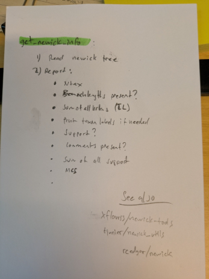

# Get Newick Info

## Description

Program for reading a file in newick format, and report

## Report for each input file

- [X] Number of trees: integer
- [X] Number of tips: integer
- [X] Branch lengths present: true or false
- [X] Rooted tree: true or false
- [X] Dichotomous: true or false
- [X] Comments present (NHX or Enhanced Newick format): true or false
- [X] Is the tree ultramteric: true or false
- [X] Tree height: sum of branch length from root to tip (if ultrametric): numerical
- [X] Tree length, TL: Sum or all branch lengths: numerical
- [X] Print taxon labels (optional, default false): sorted list of strings
- [X] Print support values (optional, default false): numerical
- [X] Print TL only (optional, default false): numerical
- [X] Sum of all support values: numerical
- [X] MRP - Mean resampling proportion: numerical
- [X] Standard deviation of RP ($s_{RP}$): numerical
- [X] MCS - Mean character support: numerical
- [X] Standard deviation of CS ($s_{CS}$)🚡: numerical

## TODO

- [X] Add calculations and reporting of standard deviation of RP and CS
- [ ] Finish a readable README.md
- [ ] Check [src/README.md](src/README.md) for more on TODO
- [ ] Test with multi-tree files: are properties reported meaningful or not on
  many trees? Or should they be lifted out as separate options?
- [ ] Test with BEAST-extended files
- [ ] Test with almost-ultrametric files
- [ ] Test with rooted/unrooted trees
- [ ] Make sure reading scientific numbers works
- [X] Change the implementation of needing n-3 support values: use all support values that can be found!
- [ ] Test on consensus trees with support values

## See also

- <https://jeetsukumaran.github.io/DendroPy/programs/sumtrees.html>
- <https://github.com/xflouris/newick-tools>
- <https://github.com/tjunier/newick_utils>
- <https://github.com/rcedgar/newick>
- <https://biopython.org/wiki/Phylo>
- <https://jeetsukumaran.github.io/DendroPy/>
- <https://gist.github.com/Ad115/34dfc6560b64779a40c1a929f560511b>
- <https://github.com/ANGSD/newick>
- <https://gist.github.com/joemarct/5263462>

